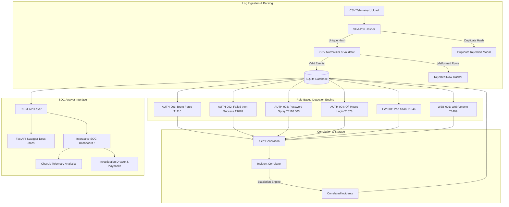

# Mini-SIEM (Security Information and Event Management)

Mini-SIEM is an educational, production-grade Security Information and Event Management prototype built with **Python**, **FastAPI**, **SQLite**, and **Chart.js**.

It simulates how modern Security Operations Center (SOC) platforms ingest multi-source telemetry, normalize event logs, enforce cryptographic duplicate rejection, apply rule-based detection engineering with **MITRE ATT&CK&reg;** mapping, correlate alerts into unified security incidents, and present live analytics to SOC analysts.

Designed as an end-to-end cybersecurity portfolio project for security analyst and engineering interviews.

---

## Architecture Overview



---

## Core Capabilities

### 1. Cryptographic Ingestion & Defensive Parsing
- **SHA-256 File Hashing:** Every uploaded log is fingerprinted. Identical files are instantly detected and rejected (`HTTP 200 {"status": "duplicate"}`), preventing audit log pollution.
- **Physical Row Numbering:** Row-level validation skips corrupted timestamps or invalid outcomes while recording exact physical row numbers (e.g. `[Row #4, Row #9]`) for analyst review.
- **Dual Format Support:** Accepts the official 7-column schema (`timestamp,source,username,source_ip,event_type,outcome,user_agent`) and optional firewall/web telemetry (`dest_ip,dest_port,protocol,request_path,status_code`), with backwards compatibility for legacy 4-column auth logs.

### 2. Multi-Rule Detection Engine & MITRE ATT&CK Mapping
- **AUTH-001 (Brute-Force Login):** Detects $\ge 5$ failed logins from the same source IP within a 10-minute sliding window. &rarr; **T1110 (Brute Force)**.
- **AUTH-002 (Failed Login Followed by Success):** Identifies suspicious sequences where failed login attempts are followed by a successful login for the same user and IP, indicating successful credential compromise. &rarr; **T1078 (Valid Accounts)**.
- **AUTH-003 (Repeated Suspicious Login Activity):** Detects password spraying attempts targeting $\ge 3$ distinct user accounts from a single IP. &rarr; **T1110.003 (Password Spraying)**.
- **AUTH-004 (Login Outside Business Hours):** Flags successful authentications occurring outside configured operating hours (default 08:00&ndash;18:00) or weekends. &rarr; **T1078 (Valid Accounts)**.
- **FW-001 (Port Scan Reconnaissance):** Detects connection attempts across $\ge 5$ distinct destination ports from a single IP within 5 minutes. &rarr; **T1046 (Network Service Discovery)**.
- **WEB-001 (High Request Volume Anomaly):** Flags HTTP request floods ($\ge 30$ requests/minute) when web server telemetry is present. &rarr; **T1499 (Endpoint Denial of Service)**.

### 3. Incident Correlation & Investigation Playbooks
- **Entity Correlation:** Merges multiple alerts sharing source IPs, usernames, and temporal proximity into single incidents.
- **Multi-Stage Attack Escalation:** If an incident exhibits both `AUTH-001` (Brute Force) and `AUTH-002` (Successful Login), the incident automatically escalates to **CRITICAL** severity.
- **Incident Lifecycle Management:** Supports live SOC analyst triage statuses: `Open`, `Investigating`, `Resolved`, and `False Positive`.
- **Investigation Drawer:** Provides an interactive drill-down showing attack timelines, affected users, MITRE technique explanations, and actionable remediation steps.

### 4. Interactive SOC Analyst Dashboard
- Single-page dark-mode web interface served directly by FastAPI at `http://127.0.0.1:8000/`.
- Real-time **Chart.js** visualizations:
  - 24-hour ingestion activity timeline (line chart)
  - Successful vs failed vs blocked login ratios (doughnut chart)
  - Alert breakdown by severity (bar chart)
  - Incident queue by investigation status (bar chart)
  - Telemetry source breakdown (bar chart)
  - Top suspicious IP addresses ranked by failure count
- Drag-and-drop CSV log file uploader with live upload summary, duplicate banners, and rejected row pills.

---

## Project Structure

```
MiniSIEM/
│
├── app/
│   ├── main.py                     # FastAPI application entrypoint & static mount
│   ├── database.py                 # SQLite storage, migrations, and parameterized queries
│   ├── schemas.py                  # Pydantic schemas for request/response validation
│   │
│   ├── routers/                    # Modular API route controllers
│   │   ├── logs.py                 # POST /api/logs/upload, GET /api/logs, GET /api/logs/{id}
│   │   ├── alerts.py               # GET /api/alerts, POST /api/alerts/run-detection
│   │   ├── incidents.py            # GET /api/incidents, GET /api/incidents/{id}, PATCH status
│   │   └── dashboard.py            # GET /api/dashboard/stats
│   │
│   ├── services/                   # Core business logic
│   │   ├── csv_parser.py           # Defensive CSV parser, row numbering & ISO 8601 parsing
│   │   ├── detection_engine.py     # 6 Security detection rules & sliding time windows
│   │   ├── incident_correlator.py  # Alert grouping, multi-stage escalation & deduplication
│   │   └── mitre_mapper.py         # MITRE ATT&CK technique definitions & SOC playbooks
│   │
│   └── static/                     # Frontend SOC dashboard
│       ├── index.html              # Modern, responsive single-page dashboard layout
│       ├── styles.css              # Cyber dark-theme SOC styling
│       └── app.js                  # Frontend controller & Chart.js rendering
│
├── sample_logs/                    # Realistic test datasets
│   ├── sample_logs.csv             # Baseline authentication logs
│   ├── auth_sample.csv             # Brute-force, spray, off-hours, and success-after-fail
│   ├── firewall_sample.csv         # Multi-port scanning network telemetry
│   └── web_sample.csv              # High-volume web server HTTP access flood
│
├── tests/                          # 50 Automated unit tests
│   ├── test_api.py                 # API uploads, hashing, duplicate prevention & pagination
│   ├── test_database.py            # SQLite schema migrations, constraints & persistence
│   ├── test_detector.py            # Baseline brute force & sliding window logic
│   ├── test_rules.py               # Dedicated tests for all 6 detection rules
│   ├── test_correlation.py         # Incident correlation & multi-stage escalation
│   ├── test_incident_api.py        # Incident CRUD, PATCH status, and dashboard stats
│   └── test_mitre.py               # MITRE ATT&CK mapping lookups
│
├── main.py                         # Command-line SOC analysis runner
├── check_db.py                     # Database inspection utility
├── minisiem.db                     # Local SQLite database (git-ignored)
├── requirements.txt                # Pinned production dependencies
├── pytest.ini                      # Pytest discovery configuration
├── PROJECT_JOURNAL.md              # Milestone tracking & engineering journal
└── README.md                       # Complete project documentation
```

---

## Installation & Setup

### Prerequisites
- **Python 3.10+** (tested on Python 3.14.4 on Windows)
- **PyCharm** or any preferred IDE

### 1. Clone & Set Up Virtual Environment

```powershell
cd C:\Users\tejas\PycharmProjects\MiniSIEM
python -m venv .venv
.\.venv\Scripts\Activate.ps1
```

### 2. Install Dependencies

```powershell
pip install -r requirements.txt
```

---

## How to Run

### Option A: Run the Web Dashboard & REST API Backend

Start the Uvicorn server:

```powershell
uvicorn app.main:app --reload --port 8000
```

1. Open **Interactive SOC Dashboard**: Navigate to [`http://127.0.0.1:8000/`](http://127.0.0.1:8000/) in your web browser.
2. Open **Interactive Swagger API Documentation**: Navigate to [`http://127.0.0.1:8000/docs`](http://127.0.0.1:8000/docs).

### Option B: Run the Command-Line Analyst Runner

Analyze sample log files directly in the terminal:

```powershell
# Analyze baseline logs
python main.py sample_logs/sample_logs.csv

# Analyze advanced multi-rule authentication logs
python main.py sample_logs/auth_sample.csv

# Analyze firewall port scan logs
python main.py sample_logs/firewall_sample.csv

# Analyze web server access logs
python main.py sample_logs/web_sample.csv
```

---

## REST API Reference

| Method | Endpoint | Description |
| :--- | :--- | :--- |
| `GET` | `/` | Serves the interactive SOC analyst web dashboard. |
| `GET` | `/api/health` | Health check endpoint returning service status and server time. |
| `POST` | `/api/logs/upload` | Uploads a CSV log file with SHA-256 duplicate detection and automatic rule detection. |
| `GET` | `/api/logs` | Retrieves stored security events with `limit` and `offset` pagination. |
| `GET` | `/api/logs/{event_id}` | Retrieves a single security event by its primary key ID. |
| `GET` | `/api/alerts` | Lists detection alerts with optional `rule_id` and `severity` filters. |
| `POST` | `/api/alerts/run-detection` | Executes all detection rules across stored events and correlates incidents. |
| `GET` | `/api/incidents` | Lists correlated incidents with `status` and `severity` filters. |
| `GET` | `/api/incidents/{incident_id}` | Returns comprehensive incident details, related alerts, event timeline, and MITRE playbooks. |
| `PATCH` | `/api/incidents/{incident_id}` | Updates incident lifecycle status (`Open`, `Investigating`, `Resolved`, `False Positive`). |
| `GET` | `/api/dashboard/stats` | Returns real-time aggregate metrics for dashboard KPI cards and Chart.js charts. |

---

## Running Automated Tests

All tests run in completely isolated temporary SQLite databases (`tempfile.TemporaryDirectory`), guaranteeing that `minisiem.db` is never corrupted during test runs.

Run the entire test suite:

```powershell
pytest -v
```

### Verified Test Results
```
============================== test session starts ==============================
collected 50 items

tests/test_api.py::TestMiniSIEMApi .............                          [ 26%]
tests/test_correlation.py::TestIncidentCorrelator ...                     [ 32%]
tests/test_database.py::TestMiniSIEMDatabase .........                    [ 50%]
tests/test_detector.py::TestMiniSIEMDetector ........                     [ 66%]
tests/test_incident_api.py::TestIncidentAndDashboardApi ....              [ 74%]
tests/test_mitre.py::TestMitreMapper ....                                 [ 82%]
tests/test_rules.py::TestDetectionRules .........                         [100%]

======================== 50 passed, 1 warning in 8.55s ========================
```

---

## Sample Datasets

Four ready-to-use CSV datasets are provided in `sample_logs/`:

| Dataset | Telemetry Type | Scenarios Simulated |
| :--- | :--- | :--- |
| `sample_logs.csv` | Authentication | Baseline failed and successful logins, normal traffic, brute-force bursts. |
| `auth_sample.csv` | Authentication | Rapid brute-force (`AUTH-001`), password guessing success (`AUTH-002`), password spray (`AUTH-003`), off-hours login (`AUTH-004`). |
| `firewall_sample.csv` | Network / Firewall | Normal allowed connections, port scan probing 8 distinct destination ports (`FW-001`). |
| `web_sample.csv` | Web Server HTTP | Standard web requests, rapid 35-request flood attack (`WEB-001`). |

---

## Scope & Limitations

- **Educational Simulation:** Mini-SIEM is designed as a demonstration project using simulated CSV log telemetry. It does not monitor real-world production employee machines or live enterprise endpoints.
- **Log Source Scope:** Optimized for simulated authentication, network firewall, and web server logs.
- **Database Engine:** Uses SQLite with WAL-compatible transactions and parameterized queries, ideal for standalone portfolio demonstrations.
